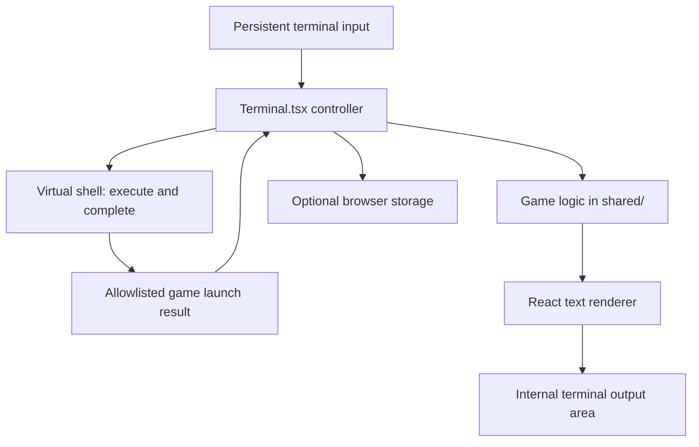

# Games architecture

This is the entry point for the implementation design of the three built-in games. It describes the current code. The [original adventure plan](lunas-adventure-plan.md) records the gameplay design; the adventure design below explains how that design is implemented and extended.

| Game | Design document | Virtual entry | Main engine |
| --- | --- | --- | --- |
| 2048 | [2048 design](2048-design.md) | `~/games/2048.game` | [shared/game2048.ts](../shared/game2048.ts) |
| Bonsai | [Bonsai design](bonsai-design.md) | `~/games/bonsai.game` or `bonsai` | [shared/bonsai.ts](../shared/bonsai.ts) |
| Luna's adventure | [Architecture and expansion guide](lunas-adventure-design.md) | `~/games/lunas-adventure.game` | [shared/adventure.ts](../shared/adventure.ts) |

## Shared terminal architecture

The games run in the browser. Their logic does not depend on the Express server, database, admin editor, or a real filesystem. Game entries are built into [shared/shell.ts](../shared/shell.ts). They are not editable portfolio entries.



[src/Terminal.tsx](../src/Terminal.tsx) owns the command input, shell directory, shell history, output blocks, focus, and active interaction. A launch result selects a game mode. Subsequent input goes to that mode rather than `execute()`. Quitting clears the active mode and restores the shell prompt without changing the working directory. This is implemented with separate React state values, rather than a single formal mode enum.

The renderers produce selectable text in the existing terminal. They do not create a separate route, canvas, page layout, or command buttons. The title bar and muted copyright footer remain the only public chrome. The public page does not scroll; `.terminal-output` scrolls internally and the command line sits outside it.

## Rendering and state ownership

| Game | Controller | Output behaviour | Persistent data |
| --- | --- | --- | --- |
| 2048 | `Terminal.tsx` | One live board; a finished snapshot is appended on exit | Personal best under `luna-2048-best`; no saved board |
| Bonsai | `Bonsai.tsx`, exposed through `BonsaiHandle` | One live tree; the current snapshot is appended on exit | None; a seed can reproduce a tree |
| Adventure | `Terminal.tsx` calling the pure engine | Commands and responses append to scrollback | Validated game state under `luna-adventure-save` |

Browser storage is optional. 2048 ignores best-score storage failures. The adventure explains failed saves and keeps newer state in memory for the current visit. No game state is submitted to the server.

## Keyboard and viewport contract

The terminal handles selected-text copying before cancellation. Ctrl+C with no selection exits the active game; Ctrl+Shift+C attempts to copy selected text. Escape clears output selection and focuses the input. Page Up/Down move terminal scrollback. Shift+Tab can reach links and media rather than issuing a game action.

Shell and adventure completion/history use `replaceInput()` to pair replacement text with its cursor position. A layout effect applies the position with the controlled input's commit. New keyboard input, typing, pointer activity, or blur cancels any pending position. Cursor movement must finish before later user editing; deferred animation-frame cursor moves can overwrite a new selection. [tests/e2e/input.spec.ts](../tests/e2e/input.spec.ts) exercises selection, mid-line completion, history edits, and draft restoration with delayed frames on desktop and mobile.

Ctrl+L clears earlier output without resetting game state. The live 2048 board or bonsai remains mounted; the adventure replaces scrollback with the current room description. Bonsai screensaver mode is an exception: it consumes non-copy keypresses before the normal terminal shortcuts and exits.

Desktop games can handle immediate keydown events. On touch devices, typed commands followed by Enter remain available because soft keyboards may not emit useful keydown events. The terminal uses `visualViewport` to track the space left by the keyboard. [src/styles.css](../src/styles.css) uses container queries for compact live-game layouts; [src/themes.css](../src/themes.css) supplies colours inherited from the selected terminal theme.

Follow-to-bottom is conditional. Selecting text or navigating scrollback must not cause output to jump. A resize is distinguished from deliberate scrolling so viewport reflow does not disable following accidentally.

## Adding another built-in game

1. Put browser-independent rules in `shared/` and a text renderer in `src/`.
2. Register its virtual entry and readme in `filesystem()` in `shared/shell.ts`. Extend `Node` and `ShellResult` with an explicit launch type.
3. Add its controller, prompt, input dispatch, cancellation, and exit handling in `Terminal.tsx`. Choose whether it redraws in place or appends responses.
4. If retaining a final live-game view, extend the `Block` union and render that snapshot without active controls or timers.
5. Keep state local unless there is a concrete need for persistence. Validate saved data and tolerate storage failure if persistence is added.
6. Cover rules, shell launch/completion, text rendering, keyboard controls, selection, and desktop/mobile containment.

Use allowlisted commands and virtual paths. Do not introduce shell execution, `eval`, or operating-system processes for game behaviour.

## Verification

Rule and rendering tests live in `tests/`; browser walkthroughs live in `tests/e2e/`. Each individual design lists its relevant files and focused test commands. For a change spanning terminal integration, run:

```bash
npm run check
npm run test:e2e
```

Playwright starts isolated development servers and uses test data. Its screenshots are written to ignored `artifacts/`, and traces to ignored `test-results/`. For custom browser installations, prefix the browser command with `PLAYWRIGHT_BROWSERS_PATH=/path/to/browsers`. Deployment and browser installation instructions are in the [README](../README.md).
