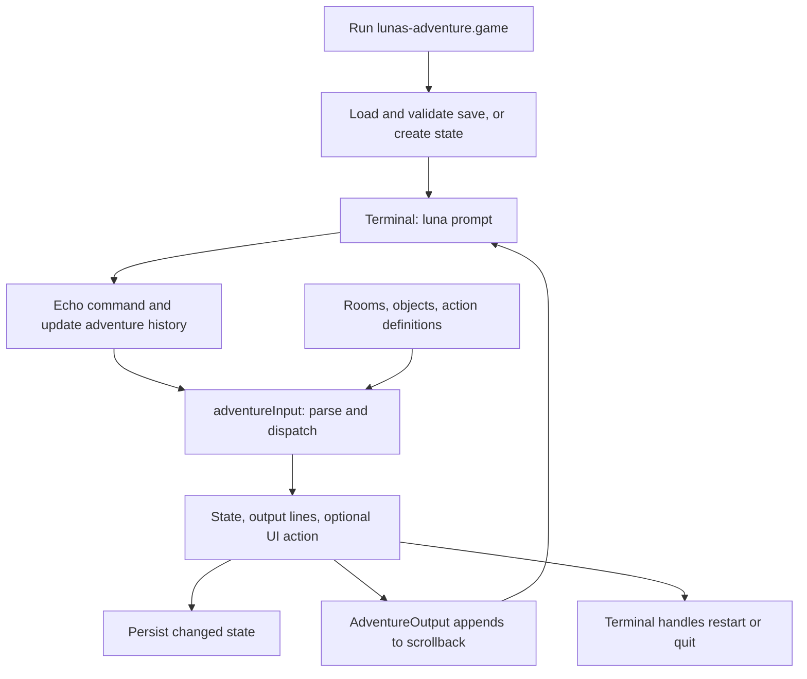

# Luna's adventure: architecture and expansion guide

Luna's adventure is a command-driven story set in Peter's house. The player explores seven rooms as Luna, gets breakfast and a treat, and finds her missing mouse. Two optional puzzles and the fox scene provide more to explore. There is no clock, combat, or losing state.

This document describes the current implementation, then gives recipes for extending it. The examples in the expansion section are proposed additions, not existing game content. See the [shared games architecture](games-design.md) for terminal integration and the [original gameplay plan](lunas-adventure-plan.md) for the earlier design.

## Source map

| File | Responsibility |
| --- | --- |
| [shared/adventure-content.ts](../shared/adventure-content.ts) | Rooms and exits, object names/aliases/actions, story copy, ASCII map, help/readme |
| [shared/adventure.ts](../shared/adventure.ts) | State, parser, movement, visibility, interactions, quests, hints, completion, save validation/migration |
| [src/Terminal.tsx](../src/Terminal.tsx) | Launch/quit, command echo/history, persistent prompt, restart confirmation, saving, scrollback |
| [src/AdventureOutput.tsx](../src/AdventureOutput.tsx) | Selectable text lines, semantic tones, ASCII map |
| [src/adventure-storage.ts](../src/adventure-storage.ts) | Local-storage boundary and load/save failure handling |
| [shared/shell.ts](../shared/shell.ts) | Virtual game entry, instructions, launch result |
| [src/styles.css](../src/styles.css) | Wrapped output and map sizing within the terminal |

## Command and rendering flow



The engine is synchronous and independent of React, the DOM, storage, and the server. `adventureInput(state, input)` returns an `AdventureResult` with a new or unchanged state, `AdventureLine[]`, and optionally `action: 'restart' | 'quit'`. It never executes input as JavaScript or a shell command. Transitions copy state and nested collections rather than mutating the supplied state.

`Terminal.tsx` handles effects: echoing commands, keeping a separate adventure history, saving changes, and asking for restart confirmation. The engine requests a restart but does not reset progress itself. The UI consumes `yes`/`no` (also `y`/`n`) before calling the engine again. Quit restores the existing shell directory and history.

Output lines contain plain text, an optional tone (`heading`, `dim`, `error`, or `success`), and a `map` flag. `AdventureOutput` renders ordinary lines as text and maps as a `<pre>`. React escapes the text; adventure content is not interpreted as HTML or Markdown. Previous responses remain in scrollback rather than redrawing a room panel. All content stays inside the terminal.

## World and state model

The room graph is explicit and bidirectional:

```text
             Bedroom
                |
Bathroom -- Upstairs hall -- Office
                |
              stairs
                |
         Downstairs hall
                |
          Sitting room
                |
             Kitchen
```

`RoomId` is derived from `roomIds`; `rooms` provides each room's description and connected exits. `move()` checks that a destination exists and is adjacent. The office also requires `officeDoorOpen`. Scratching its door in the upstairs hallway opens it and moves Luna inside; Peter goes back to his desk. Later entry is ordinary movement.

`AdventureState` stores:

- A save version, current room, and furniture position: `floor`, `chair`, `shelf`, `couch`, or `sink`.
- Boolean quest/discovery flags, including optional puzzles and `foxSeen`.
- Item locations: a room, `'carried'`, or `null` for an undiscovered mouse/ball.
- `done`, containing IDs of flavour actions already performed, and per-step hint counters.

Room and furniture position are separate. Movement resets position to the floor. `climb shelf` describes the route across the chair and desk in one action; it does not require three movement commands. `down` or `climb down` leaves furniture before attempting to use the stairs. Position must agree with the room when restoring a save.

Peter's location is derived by `peterRoom()`: office until `bowlFilled`, then kitchen. There is no NPC movement timer or separate saved Peter location. Once Luna has been fed, the bowl remains filled in quest terms even after `fed` records eating; descriptions show the empty bowl correctly.

## Objects, visibility, and actions

The `objects` record uses stable internal IDs, such as `backDoor`, with player-facing names and optional aliases. Each object has inspection copy, a static room where appropriate, and an `actions` map. An action is either:

- A flavour response with `first` and `again` text. The engine records `verb:objectId` in `done` so repeats use the second response.
- `'story'`, which routes to explicit state-dependent logic in `story()`.

Inspection has its own dispatcher because looking closely can reveal things or change copy. For example, inspecting the wardrobe reveals the gown; inspecting the sink reveals the plug and trapped ball. Pawing the tap also has a special dispatch rule: on the sink rim it runs puzzle logic, while on the floor it uses flavour copy.

`visibleObjects()` is the shared boundary for room listings, valid targets, and completion. It handles carried items, Peter's location, and discoveries. The cushion is absent until `noteFound`; the ribbon appears once `jarReady`; the note appears after the book falls. A discovered note can also be read from elsewhere as a remembered clue. Naming a hidden object does not bypass discovery.

`interactionTargets()` filters visible objects by the requested action. `drop` lists only carried items. `completeAdventure()` uses those targets, so Tab suggests real actions and respects puzzle visibility. Completion indicates available targets; it does not guarantee an action's prerequisites are met, such as having climbed high enough.

The parser trims, lowercases, and collapses whitespace; it splits the first word as the verb and keeps the remaining multiword target. It recognises aliases such as `examine`, `get`, and `bat`, selected prepositions, an optional `the`, and quotes surrounding an entire target. It is not a general shell tokenizer. Commands longer than 512 characters, missing targets, invalid rooms, and unsupported actions return helpful text.

## Quest transitions

| Thread | Actions and prerequisites | State changes |
| --- | --- | --- |
| Office access | `up`, then `scratch door` | `officeDoorOpen`; Luna enters office |
| Breakfast | `meow` near Peter, then `eat` in kitchen | `bowlFilled`, then `fed`; Peter moves to kitchen |
| Treat | `purr` near Peter after bowl filled, then play near him | `jarReady`, then `treatEarned`; ribbon becomes available |
| Missing mouse | `climb shelf`, `knock book`; downstairs `climb couch`, `push cushion`, `take mouse` | `bookDown` and `noteFound` together; `cushionMoved` reveals mouse; collection sets `mouseFound` |
| Wardrobe den | `inspect wardrobe`, `paw gown`, `push wardrobe`, `hide wardrobe` | `wardrobeInspected`, `gownFreed`, `wardrobeOpen`, `denClaimed` |
| Trapped ball | `inspect sink`, `climb sink`, `push plug`, `paw tap`, `paw ball` | `sinkInspected`, `plugClosed`, `basinFilled`, `ballRescued`; ball lands in bathroom and Luna returns to floor |
| Fox scene | `inspect glass back door` in kitchen | `foxSeen`; first/repeat copy changes |

The sock, mouse, and rescued ball can be carried and dropped in any room. Use `take` to collect a toy; playing with one on the floor leaves its location unchanged. Playing with the ribbon or a portable toy near Peter can earn the treat once the jar is ready. Finding the mouse is permanent; dropping it does not undo the objective.

`adventureInput()` checks for `fed && treatEarned && mouseFound` after dispatch. It sets `completed` and appends the ending once. Optional puzzles do not enter that condition and remain playable afterwards. Main objectives can be completed in different orders, subject to their own prerequisites.

## Hints

`hint()` chooses a stage from quest flags, room, and position. Each stage has three increasingly specific responses. Its saved counter increases to a maximum of three, and further requests repeat the final clue. Changing stages uses that stage's own counter.

Plain `hint` follows food, then treats, then toy. Optional puzzles require `hint bedroom` or `hint bathroom`. Completed quests return a short completion response. `hintSteps` defines the allowed saved keys; its first ten keys also identify the legacy version-one schema.

## Saves and validation

`src/adventure-storage.ts` stores JSON under `luna-adventure-save`. Loading reports `new`, `resumed`, `invalid`, or `unavailable`. `Terminal.tsx` writes at launch, after state changes, and on normal quit. A migrated save is therefore persisted in the current format on launch.

Saves are currently version two. `restoreAdventure()` rejects oversized input, malformed JSON, unknown versions, missing fields, invalid rooms/positions, and inconsistent progression. Examples of enforced relationships include:

- A closed office cannot coexist with being inside it, a filled bowl, or a discovered note.
- Claimed den implies open wardrobe, which implies freed gown, which implies inspection.
- Rescued ball implies filled basin, which implies closed plug, which implies inspection.
- `bookDown` equals `noteFound`; revealed mouse/ball flags agree with item locations.
- `completed` equals the three main objectives being complete.

It also validates unique known flavour-action IDs and the exact hint-key set with bounded integer counters. The returned state copies only known fields and collections. Successful JSON parsing alone is not sufficient validation.

Version-one migration preserves existing progress, adds an open office door to match the old world, starts optional puzzles fresh, adds a null ball location, and fills new hint counters. It validates the old hint shape and does not invent missing old required fields. Old saves that found the mouse before finding the note remain compatible when otherwise consistent.

If reading or writing storage fails, the terminal explains that progress lasts for this visit. It retains the latest state in memory so quitting and relaunching still works without reload. After a write failure, that session stops attempting a save after every command. No adventure progress is stored in SQLite or sent to the server.

## Expanding the game

### Edit game copy

Room descriptions, object inspection/flavour responses, shared story copy, help, and readme text live in `shared/adventure-content.ts`. State-dependent responses and hints also live in `shared/adventure.ts`. Copy changes do not require save migration if object IDs, action IDs, and state fields stay the same.

Update quoted examples in the [gameplay plan](lunas-adventure-plan.md) when changing their source text. Ending checks use the exported `copy.ending` in both engine and browser tests, so they check the current response and still catch repeated endings after an edit. Keep progression assertions separate from the wording.

### Add a stationary object with a repeatable action

For a simple flavour interaction, add a unique ID inside `objects` in `shared/adventure-content.ts`. For example:

```ts
soap: {
  name: 'soap',
  aliases: ['bar of soap'],
  room: 'bathroom',
  inspect: 'A slippery bar on the edge of the sink. Worth a paw.',
  actions: {
    paw: flavour(
      'You nudge the soap. It slides into the empty soap dish.',
      'You tap it again. The dish keeps it where it is.'
    ),
    sniff: flavour('Too much lavender. You step back.', 'Still lavender.'),
  },
},
```

`flavour()` is the existing local helper in that file. Object IDs/types and flavour-action IDs derive from the record. Static visibility, inspection action suggestions, repeat tracking, and Tab completion follow automatically. Update the room description if it should mention the object explicitly.

Names should read naturally, with lowercase aliases. Keep IDs, names, and aliases unambiguous: target lookup currently finds the first matching object globally before checking its availability. Reusing `door` for a different room can therefore select the office door unexpectedly. Renaming an existing object ID or removing a flavour action also changes saved `done` IDs; migrate those IDs instead of silently invalidating existing saves.

After adding the soap, a focused test could be added to `tests/adventure.test.ts`:

```ts
it('discovers and repeats the soap interaction', () => {
  let state = createAdventure();
  for (const command of ['up', 'go bathroom']) {
    state = adventureInput(state, command).state;
  }
  expect(completeAdventure('paw so', state).input).toBe('paw soap ');
  const first = adventureInput(state, 'paw soap');
  expect(first.output[0].text).toContain('empty soap dish');
  const again = adventureInput(first.state, 'paw soap');
  expect(again.output[0].text).toContain('dish keeps it');
  expect(again.state.done.filter(id => id === 'paw:soap')).toHaveLength(1);
  expect(restoreAdventure(JSON.stringify(again.state))).toEqual(again.state);
});
```

The test uses the imports already present in that test file. This addition needs no new saved fields, but save compatibility still needs review when removing or renaming existing interactions.

### Add a room

Add its ID to `roomIds`, its definition to `rooms`, and exits in both directions. Update `houseMap`, any room aliases in `roomTarget()`, help if useful, and the graph assertions in `tests/adventure.test.ts`. Add objects and check that every room is reachable.

Rooms normally need no terminal-controller change. Room validation derives from `roomIds`. Furniture positions are different: adding a new position requires updating the state type, restore allowlist and room restrictions, climb logic, descriptions, and tests. A locked exit needs explicit movement checks and an interaction to open it; merely omitting a room from a description does not gate movement.

### Add a puzzle or discovery

1. Define the dependency chain, repeat responses, and whether it is optional. Keep existing main objectives completable without optional rewards.
2. Add required flags to `AdventureState` and `createAdventure()`, and define save migration before requiring them during restore.
3. Define objects and their actions. Use `'story'` for actions that change puzzle state, then add explicit handling in `story()` or `inspect()`.
4. Gate undiscovered targets in `visibleObjects()`. Update `describeRoom()` and inspection responses as the scene changes. Completion will follow shared visibility/action rules.
5. Add prerequisite checks, then copy state using `change()` or an explicit result. Copy `items` and `hints` when changing them. Handle repeats without granting rewards twice.
6. Add goals and progressive hints. Change the final completion condition only if intentionally adding a required objective; update its restore invariant too.
7. Test premature actions, repeat actions, leaving/returning, restoration at every stage, and different completion orders.

Do not rely on the UI or completion to enforce a puzzle: players can type any known target. The engine must enforce discovery, reach, and prerequisites. Put special puzzle branches before generic play/climb handling when they would otherwise consume the action.

### Add a portable item

Portable items need more than an object definition. Add the ID to `portableIds`, its location to `AdventureState.items` and defaults, and a migration for older saves. Update the explicit item validation and known-field copying in `restoreAdventure()`.

Add a location/discovery rule to `visibleObjects()`; its sock/mouse/ball handling is currently explicit rather than fully generic. Define take/drop/play actions and any discovery restrictions. Generic portable take/drop and inventory listings use `portableIds`, but play copy currently distinguishes existing toys and falls back to mouse copy. Extend that dispatch deliberately and decide whether the new item earns a treat. Test carried visibility, room drops, recollection, and reload.

### Add an interaction or utility command

Add a new interaction verb to `interactionVerbs`; its type and command list derive from that array. Give at least one reachable object an action for it. A flavour action needs no new dispatcher; a story action does. Update help, aliases if appropriate, and the test that covers every interaction type.

A utility command such as a journal is separate: add it to `adventureCommands`, the explicit command dispatch/allowlist in `run()`, help, and any argument completion in `completeAdventure()`. The command list alone does not implement a command. Continue returning text and typed UI actions rather than executing arbitrary input.

### Add hints

Append stable keys to `hintSteps`, choose them in `hint()`, and supply three clues per stage. New quest names also need the accepted-quest list, completion list, help, and completed-quest responses updated. Adding hint keys changes the exact saved-key schema and needs migration. Keep the original first ten keys in place until version-one migration no longer depends on their order.

### Evolve the save format

For changes requiring new fields or hint keys, introduce a new version with an explicit migration from version two. Preserve the existing version-one conversion, then migrate sequentially: `1 -> 2 -> 3`. Older migration steps should use their own schema defaults rather than spreading future defaults that could reset progress unexpectedly.

Validate the older required data before adding defaults for genuinely new fields. Preserve current puzzle flags, item locations, repeated interactions, and hints. Update current-version validation, relationships, and known-field copying together. Keep the storage key stable, and add fixtures for fresh and progressed older saves, partial new puzzles, corrupt combinations, and unknown versions. Round-trip every reachable new transition through `restoreAdventure()`.

### Add richer interactions

Ordinary content, rooms, and puzzles stay in the engine/content layer. A new dialogue prompt or multistep interaction needs controller work in `Terminal.tsx`: transient interaction state, prompt text, input routing, cancellation, restart/quit behaviour, and clear-screen behaviour. Decide which parts survive reload before changing the save format.

Keep commands keyboard-driven and responses selectable. Use the existing output area and persistent input. Preserve copy selection, focus, history, Page Up/Down, and mobile keyboard sizing. Adding media would also require an explicit output type and safe renderer; current adventure lines only render text and the ASCII map.

## Verification

| Tests | Coverage |
| --- | --- |
| [tests/adventure.test.ts](../tests/adventure.test.ts) | Room graph, parsing, every action type, discovery/completion, quest orders, optional puzzles, hints, repeats, save validation/migration |
| [tests/adventure-storage.test.ts](../tests/adventure-storage.test.ts) | Load/save outcomes and blocked storage |
| [tests/adventure-rendering.test.tsx](../tests/adventure-rendering.test.tsx) | Selectable text/map and escaped input |
| [tests/e2e/adventure.spec.ts](../tests/e2e/adventure.spec.ts) | Keyboard walkthroughs, restart, save/reload, old saves, blocked/corrupt storage, optional puzzles, desktop/mobile containment |

```bash
npx vitest run tests/adventure.test.ts tests/adventure-storage.test.ts tests/adventure-rendering.test.tsx
npx playwright test tests/e2e/adventure.spec.ts
```

For engine/type changes also run `npm run typecheck`; for terminal or shell changes use the broader checks in the [shared design](games-design.md). Review desktop and mobile output, including a very short viewport with the keyboard visible. Verify the page does not scroll, the prompt stays usable, and selection and scrolling do not lose their position.
